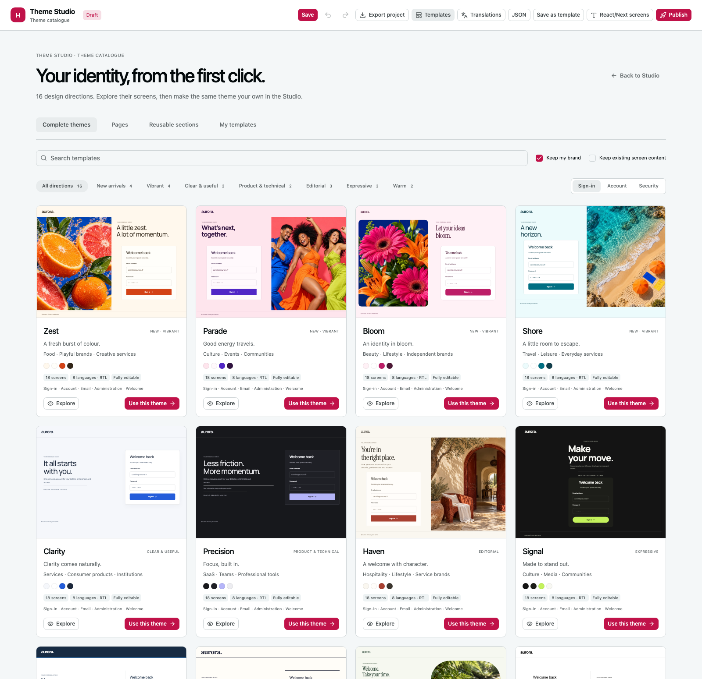

# HankoShell Theme Catalogue

[](https://github.com/Alien6-Studio/hankoshell-theme-catalog/actions/workflows/ci.yml) [](https://github.com/Alien6-Studio/hankoshell-theme-catalog/actions/workflows/codeql.yml) [](LICENSE)

The canonical source of reusable themes for Hanko Theme Studio, licensed under Apache-2.0. Theme documents, photographs, font assets, translations and authored layout recipes are maintained here. The builder owns the editor and export engines and consumes a pinned catalogue package.

**16 complete themes · 288 editable screens · 8 content languages · 8 photographic identities.**

Clarity, Precision, Haven, Signal, Civic, Edition, Ritual, Terminal, Counter, Momentum, Folio, Heritage, Zest, Parade, Bloom and Shore each contain 18 screens: login, registration, OTP, three emails, profile, security, password, authenticator setup, sessions, six administration screens and welcome. Arabic and Hebrew use RTL. Four reusable sections are also included.



Explore the themes below, with content available in all eight languages. The gallery uses the same authored pages and compositions as the editor. [Explore the theme sources](catalog/themes) or open them in [Hanko Theme Studio](https://github.com/Alien6-Studio/hankoshell-keycloak-theme-builder/tree/main/studio).

| Expressive photography | Editorial and hospitality | Product and service | Creative identities |
| --- | --- | --- | --- |
| [Zest](catalog/themes/zeste) | [Haven](catalog/themes/maison) | [Clarity](catalog/themes/evidence) | [Signal](catalog/themes/signal) |
| [Parade](catalog/themes/parade) | [Edition](catalog/themes/edition) | [Precision](catalog/themes/precision) | [Momentum](catalog/themes/mouvement) |
| [Bloom](catalog/themes/bloom) | [Heritage](catalog/themes/patrimoine) | [Civic](catalog/themes/civique) | [Folio](catalog/themes/folio) |
| [Shore](catalog/themes/rivage) | [Counter](catalog/themes/comptoir) | [Terminal](catalog/themes/terminal) | [Ritual](catalog/themes/rituel) |

## Structure

- `catalog/themes.json`: theme manifest and design metadata.
- `catalog/themes/<id>/pages/`: editable, self-contained page documents.
- `catalog/themes/<id>/assets/`: original images and optimized photographs.
- `catalog/themes/<id>/preview.png`: actual Studio preview.
- `catalog/fonts/`: font sources, embedded faces and OFL licences.
- `catalog/translations.json`: shared content translations.
- `catalog/*-prompts.json`: original image prompts and provenance.
- `src/layouts/`: authored compositions and responsive styles.
- `contracts/`: compatible declarative format and validators.
- `dist/`: generated consumer package.

## Validate and package

Requires Node 22+. No builder checkout is needed.

```sh
npm ci
npm test
mkdir -p artifacts
npm pack --pack-destination artifacts
```

Download the versioned archive, source metadata and SHA-256 checksums from the [v0.1.0 release](https://github.com/Alien6-Studio/hankoshell-theme-catalog/releases/tag/v0.1.0). npm registry publishing is not enabled. Install a downloaded archive with `npm install /path/to/alien6-hankoshell-theme-catalog-0.1.0.tgz`.

The single build script validates the documents, shares repeated media and emits a self-contained package with public TypeScript declarations and source provenance. Repeated photographs are shared in its JavaScript modules; projects retain portable raster data when materialized. Original photographs remain in this repository. `dist/source.json` records the repository, version, source revision and a SHA-256 fingerprint of the source snapshot.

```js
import {catalogue, pageTemplates, nativeThemes} from '@alien6/hankoshell-theme-catalog';
import {frameCss} from '@alien6/hankoshell-theme-catalog/frames';

const theme = catalogue.themes.find(theme => theme.id === 'bloom');
const pages = Object.fromEntries(theme.templates.map(template =>
  [template.editorPage, structuredClone(pageTemplates[template.path])]
));
```

The package also exports `translations`, asset metadata, `catalog.json`, `source.json`, font notices and the compatible JSON validator at `/contracts`. It contains no editor, React runtime, compiler or deployment service.

## Update the builder

Pass an explicitly built archive to the builder; no implicit sibling path is used:

```sh
# In hankoshell-keycloak-theme-builder
npm run catalog:update -- /path/to/alien6-hankoshell-theme-catalog-0.1.0.tgz
npm run build
npm run build:site --prefix studio
```

The update command pins the archive by SHA-256, records its provenance and updates both lockfiles. Published builder packages bundle the reviewed catalogue at build time and work without this repository or a runtime catalogue request.

## Contribute

Update a theme's own documents and layout recipe here. Keep all 18 pages, translations, original asset sources, licence metadata and SHA-256 values consistent. Do not add scripts, credentials or remote image dependencies to documents. Generic rendering, editing controls and Keycloak/React adapters belong to the builder. Contract snapshots must remain compatible with the consuming Studio version.

Inspect themes in the Studio consumer on desktop, mobile and RTL before refreshing their previews. The Studio's coherence tests compare exploration, editing and exported documents; continuity tests cover every desktop page and representative mobile pages. Design references are recorded in each theme’s manifest; original image prompts live under `catalog/`.

## Project standards

CI validates the complete catalogue, original asset hashes, portable layouts, public types and an isolated installation of the actual archive on Node 22 and 24. CodeQL runs on changes and weekly; Dependabot tracks npm dependencies and pinned GitHub Actions. Main accepts signed, reviewed changes with required checks. Release archives carry SHA-256 checksums and GitHub build provenance. Verify a download with `gh attestation verify <file> --repo Alien6-Studio/hankoshell-theme-catalog`. See [contributing](CONTRIBUTING.md) and the [security policy](SECURITY.md).
